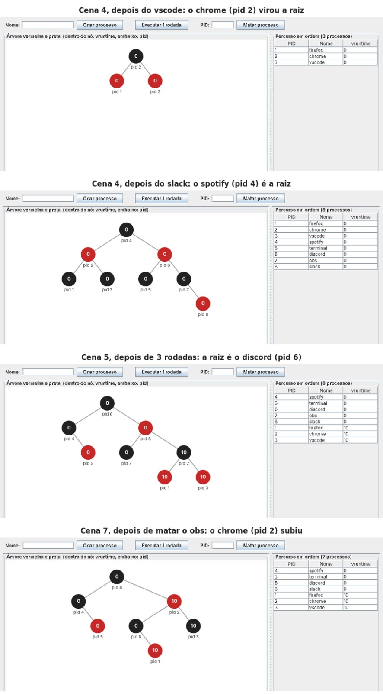

# MiniCFS - Árvore Rubro-Negra

## Objetivo do Projeto

Demonstrar o uso de uma árvore rubro-negra em um simulador de escalonamento
de processos inspirado no CFS do Linux. A aplicação permite criar processos,
executar rodadas e encerrar processos pelo PID, acompanhando a árvore e a fila
em uma interface gráfica.

Trabalho do **Grupo 26**, da disciplina de **Estruturas de Dados 2**, no semestre
**2026.2**.

## Características dos Dados e da Arquitetura

* **Processos:** cada processo possui PID, nome e tempo virtual de execução (`vruntime`).
* **Ordenação:** uma única árvore usa a chave `(vruntime, pid)`. O menor tempo tem preferência; o menor PID desempata.
* **Escalonamento:** a cada rodada, o processo com menor chave é removido, recebe um quantum fixo de **10** e é reinserido.
* **Criação:** um processo novo recebe o menor `vruntime` atual, ou zero se a fila estiver vazia. Os PIDs são únicos e crescentes na interface.
* **Interface gráfica:** desenvolvida em Java Swing, com desenho dos nós e tabela do percurso em ordem.
* **Armazenamento:** os processos ficam apenas em memória durante a execução.
* **Validações:** nome vazio, PID inválido ou inexistente, fila vazia e overflow na soma do quantum.

### Origem dos Dados

A aplicação inicia com a fila vazia. Os processos são cadastrados pelo usuário
na interface; seus nomes servem apenas para a simulação. O programa não acessa
nem controla processos reais do sistema operacional.

## Divisão de Responsabilidades

* **Gabriel Ferreira — Pessoa A:** rotações à esquerda e à direita, inserção e correção após inserir, busca pela chave, mínimo e lógica de uma rodada do escalonador.
* **Maria Laura Cabral — Pessoa B:** remoção e correção após remover, percurso em ordem, busca por PID e interface gráfica, incluindo tabela e desenho da árvore.

A integração utiliza as duas partes: uma rodada combina mínimo, remoção e
reinserção, enquanto a interface exibe o resultado pelo percurso em ordem.

## Como Funciona a Árvore Rubro-Negra

### Ordenação e Balanceamento

A árvore mantém as chaves menores à esquerda e as maiores à direita. Cada nó
recebe uma cor, vermelha ou preta, respeitando as seguintes propriedades:

1. Todo nó é vermelho ou preto.
2. A raiz é preta.
3. As folhas nulas, representadas pela sentinela `nil`, são pretas.
4. Um nó vermelho não possui filho vermelho.
5. Todos os caminhos de um nó até as folhas nulas contêm a mesma quantidade de nós pretos.

Após inserções e remoções, ajustes de cores e rotações restauram essas
propriedades. As rotações reorganizam os nós sem alterar a ordem das chaves.

### Uma Rodada do Escalonador

O escalonador encontra o menor nó, remove esse nó, soma 10 ao `vruntime` do
processo e o insere novamente. Se a fila estiver vazia, não há execução.
Se a soma ultrapassar o limite de um inteiro, a rodada é recusada antes da
remoção, preservando a fila.

O `vruntime` só deve ser alterado enquanto o processo estiver fora da árvore,
pois ele faz parte da chave de ordenação.

### Complexidade

| Operação | Custo no pior caso |
| --- | --- |
| Inserção e correção | `O(log n)` |
| Busca pela chave `(vruntime, pid)` | `O(log n)` |
| Mínimo | `O(log n)` |
| Remoção de um nó conhecido e correção | `O(log n)` |
| Uma rodada, sem atualizar a interface | `O(log n)` |
| Busca por PID | `O(n)` |
| Encerrar por PID, incluindo a busca | `O(n)` |
| Percurso em ordem e atualização da tabela e do desenho | `O(n)` |

A busca por PID percorre a árvore porque a ordenação principal é por
`vruntime`; não existe uma segunda árvore por PID.

## 💻 Como Baixar e Executar

### Pré-requisitos

* JDK 8 ou superior, com os comandos `java` e `javac` disponíveis no terminal.
* Sessão gráfica para abrir a janela Swing.
* Nenhuma biblioteca externa é necessária.

### Baixando pelo Navegador

1. No repositório, clique em **Code > Download ZIP**.
2. Extraia o arquivo e abra um terminal na pasta que contém `MiniCFS.java`.
3. Compile e execute:

```text
javac -encoding UTF-8 *.java
java MiniCFS
```

### Clonando o Projeto

```text
git clone https://github.com/eda2-2026/G26_Arvores_2026_2.git
cd G26_Arvores_2026_2
javac -encoding UTF-8 *.java
java MiniCFS
```

### Executando pela IDE

Abra a pasta em uma IDE Java, selecione um JDK 8 ou superior e execute o método
`main` da classe `MiniCFS`. Os arquivos Java ficam na raiz do projeto.

## Executando os Testes

Os testes não dependem de bibliotecas externas e podem ser executados sem
tela. Eles verificam ordenação, ponteiros de pai, propriedades rubro-negras,
busca, mínimo, chave duplicada, remoções, fila vazia e overflow.

São usadas quatro sequências de 500 inserções seguidas de remoções em ordem
aleatória, além de 3.000 rodadas com 30 processos. O teste também instancia
o painel Swing; não automatiza cliques nos botões.

### Windows — PowerShell

```powershell
New-Item -ItemType Directory -Force build | Out-Null
javac -encoding UTF-8 -d build *.java tests/TesteMiniCFS.java
java '-Djava.awt.headless=true' -cp build TesteMiniCFS
```

### Linux ou macOS

```sh
mkdir -p build
javac -encoding UTF-8 -d build *.java tests/TesteMiniCFS.java
java -Djava.awt.headless=true -cp build TesteMiniCFS
```

## 🎥 Demonstração Visual

1. Digite um nome e clique em **Criar processo**. O PID é atribuído automaticamente.
2. Crie outros processos e observe a ordem por `(vruntime, pid)`.
3. Clique em **Executar 1 rodada** e acompanhe o acréscimo de 10 e a nova posição do processo.
4. Informe um PID e clique em **Matar processo** para removê-lo.

A árvore à esquerda mostra o `vruntime` dentro de cada nó e o PID abaixo.
A tabela à direita lista os processos em ordem; sua primeira linha indica
o próximo processo a executar. A raiz da árvore não é necessariamente o mínimo.

### Apresentação em Vídeo

[Assista à apresentação do MiniCFS no YouTube](https://youtu.be/risaR9Pt2hg).

### Capturas de Tela

Os quatro registros abaixo mostram o balanceamento após inserções, a mudança
da fila após três rodadas e a remoção de um processo pelo PID. Os nomes
representam processos fictícios da simulação.



### Roteiro de Validação Manual

Crie dois processos e execute duas rodadas: ambos devem terminar com
`vruntime` 10. Crie um terceiro e confira que ele também entra com tempo 10.
Remova um processo pelo PID e confira sua saída da tabela e da árvore.
Teste ainda um nome vazio, um PID inválido e uma rodada com a fila vazia.

## Estrutura do Projeto

```text
ArvoreRubroNegra.java   Árvore, balanceamento, buscas e percurso em ordem
Escalonador.java        Execução de uma rodada com quantum fixo
MiniCFS.java            Interface Swing e comandos
PainelArvore.java       Posicionamento e desenho dos nós
Processo.java           PID, nome e vruntime
No.java                 Estrutura de um nó
Cor.java                Cores dos nós
tests/TesteMiniCFS.java  Testes de integração
docs/imagens/           Capturas de tela
```

## Limites da Versão

Simulador didático com uma única árvore, quantum fixo e sem prioridades.
Não reproduz todos os mecanismos do escalonador do Linux e não salva os
processos entre execuções. A fila é reiniciada ao fechar e abrir o programa.

## Equipe de Desenvolvimento

| Gabriel Ferreira | Maria Laura Cabral |
| :---: | :---: |
|  |  |
| [@diangellis](https://github.com/diangellis) | [@Maria-Laura-Regis](https://github.com/Maria-Laura-Regis) |
